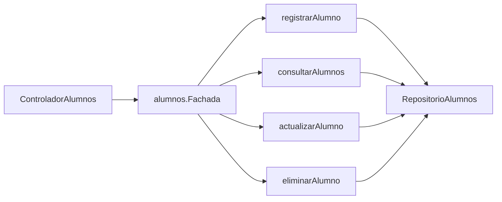
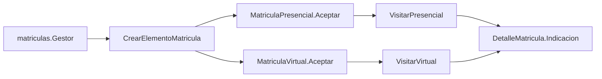

# Organización del backend

El backend está dividido en capas y en dos módulos de aplicación. En Go, la orientación a objetos se expresa mediante estructuras, métodos, interfaces y composición. Los archivos de una misma carpeta pertenecen al mismo paquete: separar métodos en archivos mantiene un solo tipo con su estado y dependencias.

## Estructura

```text
backend/
├── aplicacion/
│   ├── alumnos/
│   │   ├── fachada.go
│   │   ├── registrar.go
│   │   ├── consultar.go
│   │   ├── actualizar.go
│   │   └── eliminar.go
│   ├── matriculas/
│   │   ├── gestor.go
│   │   ├── registrar.go
│   │   ├── consultar.go
│   │   ├── actualizar.go
│   │   ├── eliminar.go
│   │   ├── guardar.go
│   │   ├── detalle.go
│   │   ├── describir.go
│   │   └── visitante_indicaciones.go
│   ├── servicio.go
│   └── autenticacion.go
├── dominio/
│   ├── alumno.go
│   ├── matricula.go
│   ├── elemento_matricula.go
│   ├── visitante_matricula.go
│   ├── matricula_presencial.go
│   ├── matricula_virtual.go
│   ├── crear_elemento_matricula.go
│   ├── repositorio_alumnos.go
│   ├── repositorio_matriculas.go
│   ├── repositorio.go
│   ├── datos_academicos.go
│   └── errores.go
├── presentacion/
│   ├── http.go
│   ├── controlador_alumnos.go
│   ├── controlador_matriculas.go
│   ├── controlador_sistema.go
│   ├── solicitudes.go
│   ├── respuestas.go
│   ├── cors.go
│   └── autenticacion.go
├── infraestructura/
│   ├── repositorio_archivo.go
│   ├── repositorio_archivo_alumnos.go
│   ├── repositorio_archivo_matriculas.go
│   ├── repositorio_supabase.go
│   ├── repositorio_supabase_alumnos.go
│   ├── repositorio_supabase_matriculas.go
│   ├── autenticacion_supabase.go
│   ├── autenticacion_local.go
│   └── configuracion.go
└── main.go
```

## CRUD de alumnos y Facade

`alumnos.Fachada` es la entrada pública. Compone cuatro casos de uso privados y delega en ellos. La lógica de cada operación vive en su archivo, mientras el controlador solo conoce los métodos de la fachada.

| Operación | Método público | Implementación |
| --- | --- | --- |
| Crear | `Fachada.Registrar` | `registrar.go` valida y guarda un alumno nuevo. |
| Leer | `Fachada.Consultar` | `consultar.go` obtiene la lista. |
| Actualizar | `Fachada.Actualizar` | `actualizar.go` valida y conserva la identidad. |
| Eliminar | `Fachada.Eliminar` | `eliminar.go` solicita el borrado al repositorio. |



## CRUD de matrículas y Visitor

`matriculas.Gestor` recibe un `RepositorioMatriculas` y un `VisitanteMatricula` en el constructor. Sus métodos `Registrar`, `Consultar`, `Actualizar` y `Eliminar` están separados. `guardar.go` comparte los pasos de validación y persistencia de creación y actualización.

`DetalleMatricula` es un DTO de respuesta. Después de guardar o consultar, `describir.go` selecciona el elemento presencial o virtual y llama a `Aceptar`. El elemento invoca el método correspondiente del visitante.



`VisitanteIndicaciones` es una implementación del contrato. Se puede inyectar otro visitante para cambiar la operación sin modificar `Aceptar`. Al agregar una modalidad nueva se debe ampliar el contrato y adaptar los visitantes existentes. Visitor genera información de respuesta; el CRUD utiliza el repositorio para persistir.

## Repositorios y consistencia

`RepositorioAlumnos` y `RepositorioMatriculas` exponen solo las operaciones de cada módulo. `RepositorioAcademico` compone ambos contratos para construir el sistema.

Los dos módulos reciben la misma instancia del repositorio. En el almacenamiento JSON esto conserva el mismo mutex y evita escrituras simultáneas sobre el archivo. `ConsultaAcademica` permite leer alumnos y matrículas en una sola fotografía consistente. El resumen lo coordina `ServicioAcademico`.

Los archivos `_alumnos.go` y `_matriculas.go` contienen los métodos de cada CRUD, pero siguen perteneciendo al mismo tipo de repositorio. El borrado en cascada continúa dentro de la operación de persistencia, evitando dejar matrículas huérfanas.

## Controladores y dependencias

`http.go` registra las rutas. Cada módulo tiene su controlador: `ControladorAlumnos`, `ControladorMatriculas` y `ControladorSistema`. La lectura de JSON, las respuestas y la política de origen se comparten en archivos propios. El control de sesión sigue en `autenticacion.go`.

Las rutas y los campos JSON de la API se conservan. Los cambios de organización afectan las importaciones internas de Go, por ejemplo `seminario4/backend/aplicacion/alumnos`.

`dominio` no importa las otras capas. Los módulos de aplicación dependen del dominio; presentación e infraestructura dependen de los contratos de aplicación y dominio. `main.go` construye el sistema.

## Verificación

Desde la raíz:

```powershell
go test ./...
```

Las pruebas en `pruebas/backend/aplicacion` comprueban la fachada, las validaciones, los contratos de cada módulo y la inyección de otro visitante. Las pruebas HTTP usan un archivo temporal para verificar ambos CRUD, el formato de las respuestas, la persistencia y el borrado en cascada.

Con el sistema local iniciado, `node pruebas/local.mjs` comprueba el acceso y los CRUD contra la API. Solo crea y elimina sus propios registros temporales.
